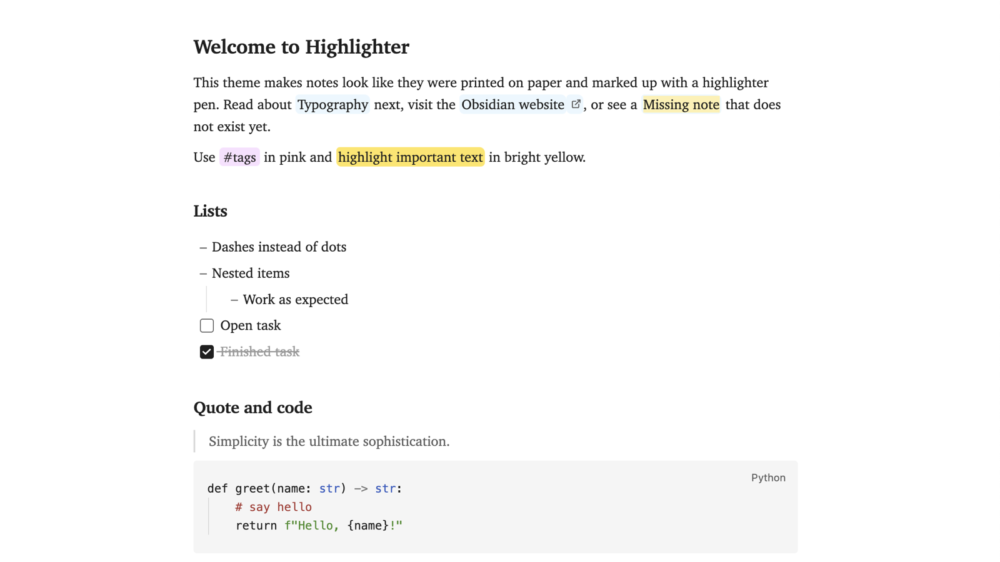

# Obsidian Highlighter theme

Minimal and clean theme for [Obsidian](https://obsidian.md).
The intention is to make notes look like printed on paper, with text highlighted using a highlighter pen:
links in blue, unresolved links in yellow, tags in pink, and `==highlights==` in bright yellow.

Typography borrows from LaTeX: notes are set in Charter (bundled with macOS), headings follow the article-class scale, and tables use the "booktabs" style.
Code blocks use the colours of [sublime-scheme-alabaster](https://github.com/tonsky/sublime-scheme-alabaster), which inspired the theme.
Lists use dashes instead of dots. The interface keeps your system font.

Works with Obsidian 1.5 and later. Designed and tested in light mode; dark mode styles exist but are untested.

Originally based on the code from [rcvd/obsidian_ia](https://github.com/rcvd/obsidian_ia).

## Screenshot

## Installation

1. In your vault, create the folder `.obsidian/themes/Highlighter/`.
2. Copy (or symlink) `theme.css` and `manifest.json` into it.
3. In Obsidian, open **Settings → Appearance → Themes** and pick **Highlighter**.

## Customising

With the [Style Settings](https://github.com/mgmeyers/obsidian-style-settings) plugin installed you can change:

- the text font: serif (Charter), system sans, or the original Helvetica;
- justified paragraphs (hyphenation is always on);
- full-size properties instead of the compact block;
- round bullets instead of dashes;
- the colour of each highlighter pen (links, unresolved links, tags, highlights), separately for light and dark mode.
